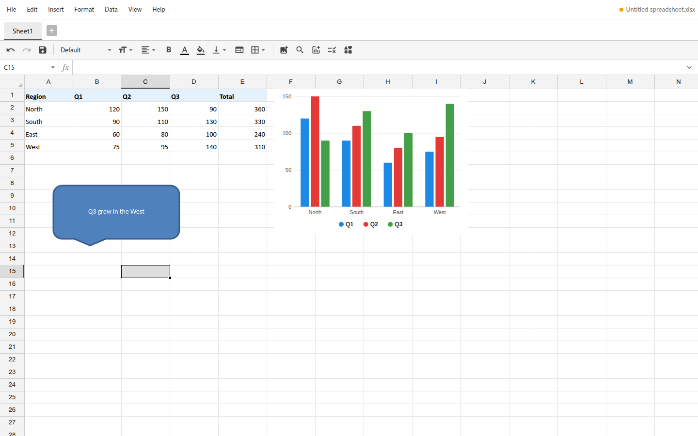
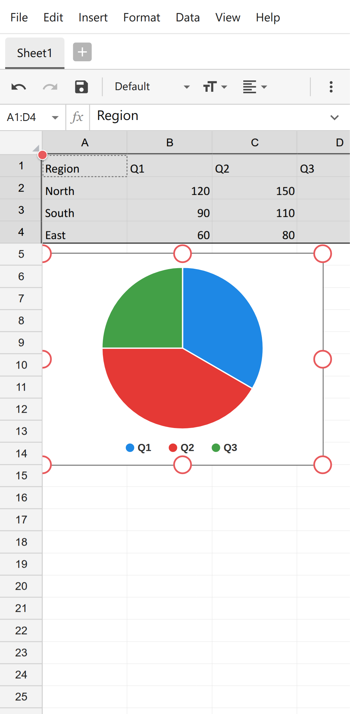
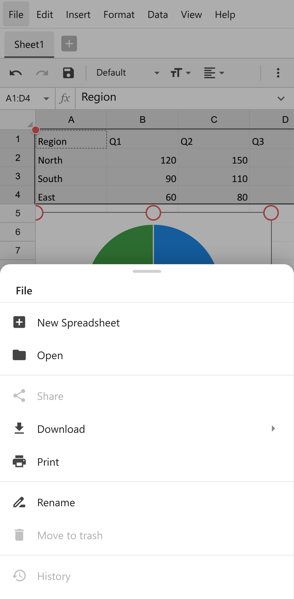

# Sumline

Sumline is an Excel (XLSX) editor for desktop and mobile that runs in the browser: formulas, charts,
shapes, sorting and filters, and printing to PDF, on its own canvas grid, formula engine and XLSX
reader and writer. On phones and tablets it has a touch layout, and it also works over a plain HTTP
address on the local network.

It comes as a React component and a Vue component, each written natively for its framework on one
shared engine, in a pnpm monorepo: `@sumline/core` (the engine, the page API and the interface
state), `@sumline/react`, `@sumline/vue`, and the full-page app built once with each component.

Its features are listed area by area in [docs/feature.md](docs/feature.md).

| Desktop | Phone | Phone menu |
| --- | --- | --- |
|  |  |  |

## Run

```bash
git clone https://github.com/mas-ony/office-sumline.git
cd office-sumline
pnpm install
pnpm dev             # the React app: http://localhost:5175, also on the LAN address Vite prints (open it on a phone)
pnpm dev:vue         # the Vue app: http://localhost:5183
                     # open a file directly: /?src=/tests/fixtures/kitchen-sink.xlsx (new workbook: /?new=1)
pnpm build           # the packages into packages/*/dist, the apps into apps/web-react/dist and apps/web-vue/dist
                     # (installable PWAs when served over HTTPS)
pnpm build:npm       # the React app without source maps in npm/dist, for the npm package
pnpm -r publish --access public  # after pnpm build: the packages in packages/ to npm (pnpm turns workspace:* into versions)
pnpm preview         # serve the React app's build on port 4175
pnpm preview:vue     # serve the Vue app's build on port 4183
pnpm test            # unit tests (formula engine, XLSX/XLS/XLSB, charts, shapes, print layout, PDF, dialog logic)
pnpm test:e2e        # Playwright against both apps, desktop and Pixel 7 profiles (Chrome at /usr/bin/google-chrome or $CHROME_PATH)
pnpm typecheck
pnpm fixtures        # regenerate the test workbooks in tests/fixtures
```

`E2E_BASE_URL=http://<LAN address>:5175 E2E_VUE_URL=http://<LAN address>:5183 pnpm test:e2e` runs
the browser tests against plain HTTP addresses, which are insecure contexts like a phone on the
local network (no clipboard API, service workers, file pickers or share sheet). The editor
feature-detects all of these.

## What works

- **Files**: a start screen with drop zone, "Create new spreadsheet" and "Upload file"; files
  open from the picker, drag and drop, `?src=` and the OS "Open with" (installed app). XLSX/XLSM
  (the saved file patches the opened package, so everything the editor does not change is
  kept), XLS (Excel 97-2003, own BIFF8 and compound-file reader) and XLSB (own BIFF12 reader)
  including formulas, styles, merges, sizes, frozen panes, names and links; CSV, TSV. Downloads
  as XLSX, CSV, TSV or PDF; save back to the opened file where the browser allows; crash
  recovery from IndexedDB.
- **Formulas**: 476 functions, dynamic arrays, names; suggestions with signature, description and
  example while typing in the cell or the formula bar; name box with defined names.
- **Menus and toolbar**: File, Edit, Insert, Format, Data, View, Help; undo,
  redo, save, font, size, alignment, bold, colours, vertical alignment, merge, borders, image,
  search, chart, validation and shape. Context menus for cells (with Paste Special), rows,
  columns, sheet tabs and objects.
- **Charts**: 23 chart types (line, area, bar and column with stacked and
  100% forms, pie, doughnut, scatter, bubble, radar, filled radar, histogram, Pareto, box and
  whisker, waterfall, funnel, treemap, stock), drawn as SVG from live data; chart settings with
  Configuration, Style and Series tabs (titles, legend, gridlines, value labels, axis titles,
  scale, colours, line styles, trendlines, markers, secondary axis); move, resize, stacking order.
  Saved as Excel chart parts (chartex for the Office 2016 types); charts in opened files are
  shown, editable and written back unchanged until edited.
- **Shapes**: the 125-shape gallery (lines and connectors, rectangles, basic forms, block arrows,
  stars, callouts, equation shapes, flowchart), Shape Settings (fill, transparent, border, font
  colour, text), saved as DrawingML shapes.
- **Data**: sorting, auto filters with value lists and conditions, data validations (lists with
  drop-downs, numbers, dates, text rules, formulas; warn, reject or highlight), freeze panes,
  footer row, column titles, search and replace, comments with replies, notes, links.
- **Print and PDF**: a preview with print options (scope, paper size, orientation,
  scaling, margins, page order, alignment, gridlines, notes, headings, page numbers, titles,
  date and time, repeated frozen rows and columns); vector PDF written by the app; printing
  through the browser's print dialog.
- **Phones**: menus and context menus as bottom sheets, long press for the cell menu, tap to
  select and double tap to edit, selection handles, pinch zoom, a key bar above the keyboard,
  toolbar overflow, full-screen dialogs, charts placed under the data.

## Programming interface

### Components

`@sumline/react` and `@sumline/vue` each export a `SumlineEditor` component and a `mount()`
function, with the same options. Both are on npm: `npm install @sumline/react react react-dom` or
`npm install @sumline/vue vue`. Import the package's `style.css` once (the fonts and the editor's
styles). The editor fills the height of its element, so give it (or its container) a height.

```tsx
import { SumlineEditor } from '@sumline/react';
import '@sumline/react/style.css';

<SumlineEditor
  style={{ height: '80vh' }}
  document="/reports/budget.xlsx"
  author="Jordan Lee"
  onReady={(api) => api.on('change', () => console.log(api.getValue('B10')))}
/>
```

```vue
<script setup lang="ts">
import { SumlineEditor, type SpreadsheetApi } from '@sumline/vue';
import '@sumline/vue/style.css';

const onReady = (api: SpreadsheetApi) => api.on('change', () => console.log(api.getValue('B10')));
</script>

<template>
  <SumlineEditor style="height: 80vh" document="/reports/budget.xlsx" author="Jordan Lee" @ready="onReady" />
</template>
```

```js
// Without writing React or Vue code (either package)
import { mount } from '@sumline/vue';
import '@sumline/vue/style.css';

const editor = mount(document.querySelector('#editor'), { startScreen: true });
const api = await editor.ready;
editor.update({ readOnly: true });
editor.destroy();
```

Options, the same props in both components (`SumlineOptions` in
`packages/core/src/ui/controller.ts`):

| Option | |
| --- | --- |
| `document` | A URL, a file handle (File System Access API: Save writes back to the file), a File, Blob, ArrayBuffer or bytes, or `{ url or data, name }`; opened again when it changes. Without it the editor starts with a blank workbook |
| `startScreen` | Start on the start screen (a drop zone, "Create new spreadsheet" and "Upload file") instead of a blank workbook; it also shows while `document` loads. Read at start |
| `readOnly` | Workbooks open view-only |
| `author` | The name on comments and notes |
| `storageKey` | Keep the recent colours and print options in localStorage under `<storageKey>-…` |
| `autosave`, `offerRecovery` | Keep unsaved changes in an IndexedDB database of this name; with `startScreen`, the start screen offers to recover them (unless `offerRecovery` is false) |
| `files` | Replace some of the file actions (New, Open, Save, Download, Print, Rename, Share) |

Events: `onReady(api)` (`@ready` in Vue), once a workbook is open (the initial document, or the
first one opened from the start screen), with the editor's page API.

The interface keeps its classes on its own element and on a layer it adds to the page's body for
menus, dialogs and pop-ups (`sl-` for the interface, `xgrid-` and `xchart-` for the grid). It
changes nothing on `<html>` or `<body>`, and several editors can share a page. In a window up to
720 pixels wide it uses its phone layout.

### Page API

Each editor comes with a page API (`packages/core/src/api/api.ts`, passed to `onReady`), which
follows the workbook the editor shows. The apps put it on the page as `window.spreadsheetEditor`
(`installPageApi` from `@sumline/core`), with methods for files, cells and sheets:

```js
const ed = window.spreadsheetEditor;
ed.setData([['Item', 'Price'], ['Pen', 1.5]], 'A1');
ed.setValue('C2', '=B2*2');
ed.setStyle('A1:B1', 'font-weight', 'bold');
ed.setFormat('B2', '"$" #,##0.00');
ed.orderBy(1, true);
ed.on('change', () => console.log(ed.getValue('C2')));
ed.download('xlsx');   // also 'csv', 'tsv'; 'pdf' opens the print preview
await ed.open(blob, 'Budget.xlsx');   // then the API serves the new workbook
```

`ed.doc` gives access to the native document model (`packages/core/src/core/document.ts`) and
`ed.grid` to the grid (`packages/core/src/grid/GridView.ts`).

## Tests

- 119 unit tests (Vitest). In `@sumline/core`: formula engine, XLSX import, export and round trips,
  document model, chart data, chart and shape rendering, charts and shapes in XLSX files (classic
  and chartex), print layout and PDF output, XLS and XLSB readers (small hand-built files plus an
  office-suite template when installed), and the toolbar and dialog logic the two interfaces share
  (toolbar fitting, number format masks, validation rules, chart settings, colours). In
  `@sumline/react` and `@sumline/vue`, the same scenarios for `mount()`: opening a workbook,
  replacing it through `update()` and cleaning up, Rename reporting a new name and menus and dialogs
  in the layer, and two editors on one page.
- 36 end-to-end tests (Playwright), the same 18 against the React app and the Vue app: 11 desktop
  (shapes and objects, opening a workbook with a chart and a picture, filters, validation, notes and
  freeze panes, sheet tabs, start screen and typing, menus and the context menu with Paste Special,
  cell formatting from the toolbar and the Format dialog, charts with settings and XLSX output,
  sorting, a CSV download with print preview and PDF download, the page API) and 7 mobile (Pixel 7:
  tap and double tap with the key bar, the key bar's keys with Functions, Done and Cancel, long
  press with the Format dialog, opening an XLS file, formatting from the overflow panel, a chart
  from the toolbar overflow, bottom-sheet menus with a download and print preview). The suite also
  passes over plain HTTP LAN addresses.

## Layout

| Path | Contents |
| --- | --- |
| `packages/core` | `@sumline/core`, everything the two interfaces share |
| `packages/core/src/core` | Workbook model, formula engine (`formula/`), XLSX package reader/writer (`xlsx/`, charts and shapes in `drawingObjects.ts`), XLS (`xls/`) and XLSB (`xlsb/`) readers, chart data, number formats, filters, validation, undo history, the `SpreadsheetDocument` command layer |
| `packages/core/src/grid` | Canvas grid (`GridView.ts`), renderer, conditional formatting, chart renderer (`chartRender.ts`), shape geometry (`shapes.ts`) |
| `packages/core/src/print` | Print layout (`pages.ts`), SVG pages for preview and printing, PDF writer |
| `packages/core/src/ui` | The interface without a framework: its state and actions (`controller.ts`, `SumlineUI`), commands, menus, formula assist, the function catalogue, icons, and the data and logic of the toolbar and dialogs (number format masks, validation rules, chart settings, print options, colour palette) |
| `packages/core/src/styles` | Fonts, grid styles (`grid.css`), interface styles (`ui.css`) |
| `packages/core/src/api` | Page API (`SpreadsheetApi`, `installPageApi`), opening files, document sources, autosave |
| `packages/core/tests` | Vitest unit tests (with small hand-built XLS and XLSB files) |
| `packages/react` | `@sumline/react`: `SumlineEditor` and `mount()`; start screen, menu bar, toolbar, formula bar, sheet tabs, menus, dialogs (`dialogs/`: format, search, charts, shapes, validations, print...), popovers, mobile key bar |
| `packages/vue` | `@sumline/vue`: the same in Vue single-file components |
| `apps/web-react` | The full-page app in React |
| `apps/web-vue` | The same app in Vue |
| `apps/web-shared` | What both apps share: `src/shell.ts` reads the address (`?src=`, `?new=1`, `?readonly=1`), turns on stored settings and autosave, sets the window title, warns before leaving with unsaved changes, opens files passed by the installed app and installs the page API; `src/app.css` has the page styles; `public/` has the icons, manifest and service worker; `vite/assetLicenses.ts` completes the builds' licence files, and `vite/testFixtures.ts` serves the test workbooks at `/tests/fixtures/` in development, for the end-to-end tests |
| `tests/e2e`, `tests/fixtures` | Playwright tests, run against both apps; test workbooks (generated by `scripts/make-fixtures.mjs`) |
| `npm` | The npm package `sumline` (the built React app): its manifest, README and licence. Packing or publishing it there (`pnpm pack`, `npm publish`) runs `pnpm build:npm` first, and the package holds only `dist` |

## Known gaps

- Excel 5.0/95 `.xls` files are not supported; XLS and XLSB files are saved as XLSX.
- Formulas that use tokens the binary readers cannot express (external workbook references,
  data tables) keep their last calculated value.
- Charts from files that use features the chart model does not cover (3-D, combination charts
  with different types) are drawn approximately; they are written back unchanged unless edited.
- Conditional formatting rules from files are shown and kept, but there is no general rule
  editor (the validation "format" action creates highlighting rules).
- Text that the standard PDF fonts cannot show (for example CJK) is embedded in the PDF as
  pictures.

## License

MIT ([LICENSE](LICENSE)). Each package in `packages/` and the npm package in `npm/` carry a copy,
with their own README for npm. The app builds write `THIRD-PARTY-LICENSES.md` next to the app,
listing the bundled packages, icons and fonts with their licences
(`apps/web-shared/vite/assetLicenses.ts` adds the fonts, which come in through CSS), and
`@sumline/core` ships one for the icons it bundles; the fonts come from the `@fontsource` packages
under the SIL Open Font License 1.1.
